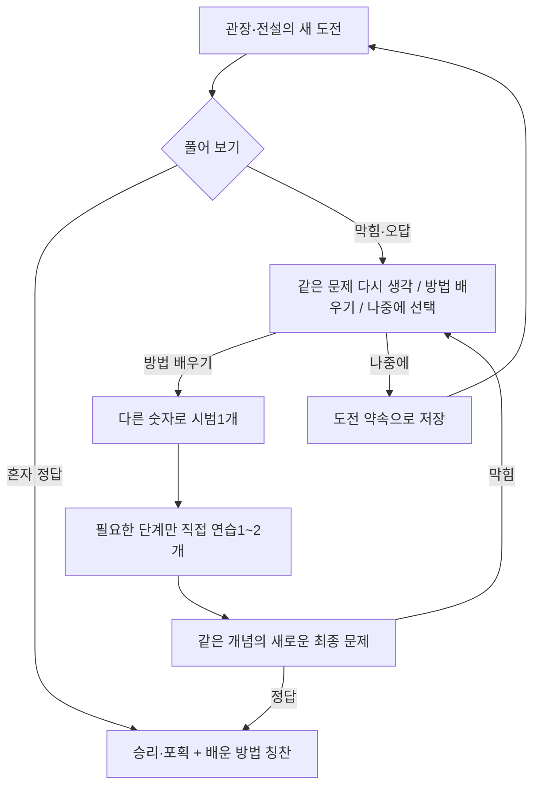

# 선율이의 포켓몬 수학 — 문제 구조 재설계

상태: 설계안 완성, 게임 실행 로직에는 아직 적용하지 않음.
기준: 2026-10-25 사용자 목적 — 수학을 재미있어 하고, 만나고 싶은 전설과 관장이 현재보다 한 단계 어려운 배움을 이끌게 한다.

## 1. 설계의 중심

성공 경험 → 궁금한 도전 → 도움을 받아 방법 발견 → 비슷한 새 문제를 스스로 해결 → 원했던 포켓몬/배지를 얻음.

핵심 성공은 단순한 정답 수나 플레이 시간이 아니라 “전에 막혔던 방법을 익혀 새 문제를 풀고, 원했던 상대를 이겼다”는 경험이다. 포켓몬은 배움을 시작하는 계기이고, 문제를 이해하고 해결하는 성취를 전투 장면과 연결한다.

현재 구현의 문제:

- 38유형의 유형별 숙련 기록이 없다. 같은 레벨이어도 유형별 체감 난이도가 크게 다르다.
- 일반전은3~4(뺄셈2 예외), 관장/전설은5로 고정한다. 모르는 유형을 갑자기 만날 수 있다.
- 거울은 처음부터 두 번 반사하는5만 있다. 그에 앞선 한 번 반사/축 바꾸기 연습이 없다.
- 오답은 즉시 skipMath로 넘어가 문제를 닫는다. 어디서 막혔고 어떤 방법을 배우면 되는지 이어 주기 어렵다.
- 정답 문구는 결과를 칭찬하지만 배운 방법을 구체적으로 설명하지 않는다.
- 희귀 전설을 놓치면 “공부해서 다시 잡겠다”보다 “운 좋은 기회를 잃었다”는 느낌이 앞설 수 있다.

따라서 문제를 더 추가하는 것보다, 기존 문제 사이에 학습 경로를 만들고 도전과 재도전을 연결한다.

## 2. 전투 등급과 수학 실력을 분리

기존 “문제 레벨1~5” 하나로 두 가지를 표현하던 방식을 바꾼다.

| 구분 | 의미 | 표시/사용 |
|---|---|---|
| 전투 등급 | 일반 / 트레이너 / 관장 / 전설 | 상대의 특별함과 보상, 전설의 희소성 |
| 학습 기술 | 받아올림, 같은 합, 세로 반사, 역산 등 | 무엇을 배우고 있는지 |
| 개념 단계 | 그 기술 안에서 무엇까지 혼자 할 수 있는지 | 유형별 출제 선택; 전역 총점으로 합치지 않음 |
| 지원 정도 | 그림·중간칸·예시·단계 힌트 | 도전을 유지하면서 배울 수 있는 도움 |

아이에게는 “레벨2/중하” 대신 “혼자 해보기 / 새로운 방법 도전 / 전설의 수학 도전”을 표시한다. 부모/개발실에는 실제 기술·단계·사용한 지원을 표시한다.

전설이 특별한 이유는 무조건 가장 어려운 문제를 뽑기 때문이 아니라, **선율이가 익힌 기술의 다음 단계에서 직접 해결해야 하는 상대**이기 때문이다. 전설/관장 실제 문제를 무조건5로 고정하는 기존 정책은 이 설계가 구현될 때 대체한다. 화면에5라고 쓰고 실제로 낮은 문제를 몰래 내는 방식은 사용하지 않는다. 구현 전까지는 기존5 고정 정책이 그대로 동작한다.

## 3. 38유형을 학습 기술로 연결

아래8묶음은 탐색/부모 화면용 분류다. 숙련은 묶음 전체가 아니라 세부 기술별로 기록한다. 예: 같은 연산 묶음에서도 받아올림 덧셈과 뺄셈 실력은 별개다. 하나를 잘했다고 다른 기술까지 올리지 않는다.

| 묶음 | 현재 유형 id | 다음 배움의 예 |
|---|---|---|
| 덧셈 | add_two, add_carry_single, add_carry_two | 받아올림 없음 → 십 묶음 만들기 → 두 자리 받아올림 |
| 뺄셈 | subtract_single, subtract_story, story_spend_chain, story_less_chain, table_story | 덜어내기 → 문장에서 덜 수 고르기 → 두 사건 잇기 |
| 관계·역산 | equal_sum, calc_puzzle, reverse_steps, digit_sum, sum_pyramid, balance, heads_feet | 알려진 수 계산 → 빈 수 → 같은 양 제거 → 조건 두 개 연결 |
| 문장 이해 | add_story, story_compare, story_combine, story_receive, story_three, story_chain, story_distance | 필요한 수 찾기 → 누구의 수인지 구분 → 두 사건 연결 |
| 같은 묶음 | times_table | 같은 수씩 세기 → 묶음 그림 → 곱셈식 |
| 규칙 | pattern, sequence, analogy, array_rule, growing_picture, number_machine, picture_progression | 한 규칙 → 변화량 → 두 규칙 연결 |
| 공간·대칭 | mirror, rotate | 한 번 반사/회전 → 다른 축 → 순서대로 두 번 → 역추론 |
| 조건·경우 | logic, latin, table_count, number_riddle, number_card_count, target_pairs | 한 조건 → 두 조건 → 빠짐없이/중복 없이 세기 |

문제 데이터는 type만이 아니라 skills, prerequisites, conceptStep, newConcept, supportOptions를 가진다. 같은 type에서도 단계에 따라 skills가 달라질 수 있다. 예: heads_feet의 실제 선행 기술은 두 개씩 세기와 더하기/빼기이며, 연립방정식 기호를 배워야 하는 것은 아니다.

### 구체적인 경로

| 기술 | 이미 할 수 있는 것 | 다음 도전 | 그다음 |
|---|---|---|---|
| 받아올림 | 두 자리+한 자리, 십 묶음 그림 사용 | 그림 일부만 주고 받아올림 | 그림 없이 두 자리+두 자리 |
| 같은 합 | 7+5의 합 | 7+□=12 | □+□+4=18에서 같은 □ 찾기 |
| 거울 | 3×3 세로축 한 번 반사 | 같은 크기에서 가로축 한 번 반사 | 대각선 한 번 → 두 번 반사 → 역추론/오류 수정 |
| 저울 | 보석1개와 추의 대응 | 보석 여러 개의 같은 무게 | 양쪽 보석 제거 → 두 저울의 단서 연결 |
| 역산 | 앞으로 +,− 순서 계산 | 두 행동을 거꾸로 되짚기 | 행동 하나 더 연결 |

대칭축 변경과 격자 확대, 반사 횟수 증가, 그림 도움 제거를 동시에 하지 않는다. 한 도전에서는 새로 생각할 요소를 원칙적으로 하나만 추가한다. 숫자를 키우는 것만으로 난이도를 높이지 않는다.

덧셈의 중간/최종 합99 이하, 음수 없는 기초 연산, 기존 뺄셈 최소2에 해당하는 기초 내용은 보존한다. 세부 기술의 단계와 예전 전역 레벨은 일대일로 대응하지 않는다.

## 4. 일반전·관장·전설의 역할

| 상황 | 출제 방식 | 원하는 경험 |
|---|---|---|
| 일반 야생 | 익숙한 기술 중심. 최근에 배운 기술을 쉬운 숫자/익숙한 표현으로 다시 만남 | “나 잘하네”, “배운 게 또 나왔네” |
| 일반 트레이너 | 익숙한 문제에 한 조건을 더하거나 읽는 대상을 바꿈 | 배운 방법을 다른 상황에도 사용 |
| 관장 | 체육관마다 주제1개. 앞의 트레이너가 필요한 방법을 연습시킴 | 준비한 방법으로 관장을 이김 |
| 전설 | 기초가 준비된 기술 중 다음 단계 하나를 제시. 선호 상대는 학습 목표로 남김 | “이 방법을 배우면 잡을 수 있겠네” |

일반전 출제 비중의 시작값은 익숙한 기술60%, 최근 배운 기술30%, 해볼 만한 다음 단계10%다. 세 비중은 제품 조정값이며 연구로 확정된 최적 수치가 아니다. 기록이 없거나 이미 연속으로 막힌 상태에서는 다음 단계10%를 익숙한 문제로 돌린다. 전투마다 정확히10문제를 강제로 내는 구조도 아니다. 기존 공격의 수학 도전 발생 빈도는 초기에는 유지해 흐름을 불필요하게 끊지 않는다.

관장의 현재 각 포켓몬 마지막 타격마다 독립된 최고 난이도 문제를 내는 방식은, 주제별 준비/도전1개를 중심으로 정리한다. 이전 포켓몬에서 이미 독립적으로 해결한 같은 개념을 의미 없이 반복 관문으로 요구하지 않는다. 관장 승리에는 마지막 독립 해결이 최소 한 번 필요하다.

### 체육관의 학습 동선 예

- 비상: 그림에서 식으로 연결하는 덧셈. 도전은 이미 익힌 덧셈에서 지원 한 단계 줄이기.
- 호일: 규칙/분류. 앞의 트레이너가 한 규칙씩 보여 주고 관장은 두 단서를 연결.
- 꼭두: 같은 양과 관계. 한 저울 → 양쪽에 있는 같은 양 제거 → 준비된 단계에서 관계 문제.

주제는 모든 아이에게 같은 절대 난이도를 뜻하지 않는다. 이미 잘하는 기술은 다음 단계로, 낯선 기술은 준비 경로를 거친다. 배지를 받기 위해 38유형을 전부 익힐 필요는 없다.

## 5. 실력 기록과 출제 결정

### 처음 시작

별도 시험 화면 없이 첫 모험의3~4개 문제를 관찰 기회로 쓴다. 아이가 좋아하는 유형을 선택할 수도 있다. 아직 풀지 않은 기술은 unknown으로 남긴다. 부모가 알려 준 현재 수준은 초기 출제 힌트로만 사용하고 정답 기록으로 만들지 않는다.

### 기록할 신호

- 문제 id, type, skills, conceptStep, seed/변형 구조
- 첫 제출 정답 / 도움 후 해결 / 아직 해결 못함 / 잠깐 멈춤
- 사용한 수학 힌트와 그림 지원
- 같은 개념의 다른 문제에서 독립 해결했는지
- 재접속/저장 복원/개발실 여부

시간은 편의 분석용으로만 두고 실력 점수/감점에 사용하지 않는다. 소리로 문제 읽어주기, 글자 확대, 조작 방식 변경은 수학 힌트로 세지 않는다. 오답 하나로 수학 능력을 단정하지 않는다.

### 최초 구현의 판단 규칙

모두 제품 설계의 초기값이며 실제 플레이를 보고 조정한다.

1. 같은 기술/같은 단계의 최근6개 서로 다른 문제 중5개 이상을 첫 제출에 수학 힌트 없이 해결하면 다음 단계를 제안한다.
2. 숫자만 바꾼 같은 시드 반복, 이미 답을 본 문제, 개발실, 동일 문항 재제출은 독립 해결 횟수로 중복 계산하지 않는다. 최소 두 가지 변형 구조가 있어야 한다.
3. 관장/전설의 다음 단계는 선수 개념이 준비된 경로에서만 하나 선택한다. 자료가 부족하면 짧은 준비 문제를 먼저 제안한다.
4. 같은 세션에서 한 기술은 최대 한 단계만 올라간다. 한 번의 연승으로 여러 단계를 뛰지 않는다.
5. 최근3문제 중2개에서 수학 힌트/오답이 필요했다면 승급을 보류하고, 다음 일반전에는 익숙한 문제나 그림 지원을 제공한다. 배운 기록을 지우거나 아이에게 “레벨 하락”을 표시하지 않는다.
6. 도움 후 정답은 성공/학습 경험으로 보상하지만 “혼자 익혔다”와 구분해 기록한다. 이후 다른 수의 새 문제에서 독립 해결을 확인한다.
7. 현재 제공할 수 있는 최고 단계를 익혔으면 관련된 다른 표현/새 기술로 연결한다. 반복 정답 수를 채우는 과제나 범위 밖 숫자를 만들어 내지 않는다.

선택 의사코드:

```text
available = prerequisite가 준비되고 실제 생성기가 지원하는 기술/단계
if ordinary:
  choose 익숙함 / 최근 배움 / 다음 단계 from available
if gym or legendary:
  choose prepared skill의 next concept step
  if next step 준비 안 됨: 선택 가능한 짧은 준비 경로 제안
persist exact challenge + learning context before rendering
```

기술별 단계와 지원 옵션이 없는 현재 고정5 전용 mirror/pattern/analogy는 준비용 변형을 먼저 구현해야 한다. 단계 숫자만 낮춰 기존 최고 난이도 그림을 보여 주지 않는다.

## 6. 막혔을 때 배우고 돌아오는 흐름



### 안내 문구

- 오답: “아직 방법을 찾는 중이야. 그림으로 같이 생각해 볼까?”
- 선택지: “한 번 더 생각하기 / 방법 배우기 / 나중에 도전”
- 방법을 배운 뒤: “이제 숫자가 다른 문제로 네 힘을 보여 줄 차례야.”
- 성공: “두 저울에서 같은 양을 맞춰 보석의 무게를 알아냈어!”

도전 문제의 답이나 완성 그림은 힌트로 공개하지 않는다. 시범은 **다른 숫자/그림의 별도 예제**에서만 풀이를 보여 준다. 최종 정답은 새로운 문항에서 직접 제출해야 한다. 힌트를 썼다고 포획 확률이나 전투 보상을 낮추지 않는다.

관장/전설에서 도움·연습·멈춤을 선택하는 동안은 세계와 상대 턴을 정지한다. 최종 제출 정답 전에는 포획/승리를 주지 않는다. 일반전의 기존 턴 규칙 변경과는 별도로 구현한다. 준비 과정은 짧게 끝낼 수 있게 하고, 강제 연습 횟수나 공부 시간으로 관문을 만들지 않는다.

### 희귀 전설과 도전 약속

- 야생에서 처음 만나는 확률은 각0.5% 그대로 유지한다. 자주 막힌다고 전설 확률을 올리거나 전설을 자동 지급하지 않는다.
- 만난 뒤 준비가 부족하면 “다시 만날 약속”으로 그 개체의 종/레벨/도전 기술을 보관한다. 도망/전멸 뒤에도 약속 화면에서 재도전할 수 있다.
- 종별 미해결 약속은1개다. 반복 접속/중복 클릭으로 같은 전설을 여러 번 받지 않는다.
- 실제 포획이 끝나면 약속은 완료된다. 다음 개체를 얻으려면 다시 야생에서 만나야 한다.
- 이후의 연습은 쉬운 문제를 많이 풀어 쌓는 입장권이 아니라, 그 개념을 배우기 위한 선택 가능한 경로다.
- 첫 포획의 희소성과 성취는 유지하면서, 실제로 얻은 만남을 학습 목표로 보존한다.

0.5%는 “새 야생 만남 확률”이고 저장된 약속으로 같은 개체에게 다시 도전하는 것은 새 추첨이 아니다. 이 구분을 부모 화면에도 분명히 표시한다.

## 7. 선율이의 한 번의 플레이 예

1. 일반전에서 십 묶음 그림을 보고 받아올림 문제를 여러 번 해결한다.
2. 뮤를 만난다. 시스템은 아직 못 배우는 이중 대칭 대신, 준비된 받아올림 경로의 다음 문제를 고른다.
3. 뮤의 도전은 같은 연산에서 그림 지원을 한 단계 줄여 직접 수를 구성하게 한다. 새 요소는 하나다.
4. 막히면 뮤가 “십 묶음을 만드는 방법을 연습하고 다시 만나자”고 약속한다.
5. 다른 숫자의 예제에서 방법을 보고, 짧은 연습을 직접 해 본다.
6. 같은 개념의 새 문제를 풀어 뮤를 잡는다. 게임은 “이제 그림이 적어도 십 묶음을 만들 수 있구나!”라고 그 방법을 칭찬한다.
7. 다음 일반전에서 조금 다른 문장/숫자로 다시 써 보고, 실제 독립 해결이 이어지는지 확인한다.

받아올림을 잘해도 대각선 반사까지 잘한다고 보지 않는다. 다음에 엔더드래곤을 만났을 때 대칭 경로가 준비되지 않았으면 갑자기 두 번 반사를 강요하지 않는다. 선율이가 “이번에는 거울 방법을 배워 잡고 싶다”고 고르면 그 경로의 짧은 준비를 제공할 수 있다.

## 8. 전설의 개성과 선택권

전설의 선호 테마는 선택 화면/대사의 개성으로 쓴다. 단일 필수 과목 장벽으로 만들지 않는다.

| 전설 | 선호 테마 | 예 |
|---|---|---|
| 뮤 | 숨은 수·규칙 | 빈 수 → 같은 합 → 관계 역산 |
| 코라이돈 | 길·연산 순서 | 두 행동 → 세 행동 → 거꾸로 처음 찾기 |
| 엔더드래곤 | 대칭·공간 | 한 축 → 대각선 → 두 번 반사 |
| 자마젠타 | 균형·관계 | 같은 양 → 양쪽 제거 → 저울 두 개 |
| 무한다이노 | 여러 단서 연결 | 한 조건 → 두 조건 → 이야기 속 조건 조합 |

선호 테마가 아직 너무 멀다면 “준비된 다른 힘으로 도전 / 이 방법 배우기 / 나중에”를 선택한다. 제일 쉬운 유형만 골라 보상을 얻는 우회는 막기 위해, 다른 힘도 그 기술의 **다음 단계** 독립 해결을 요구한다. 선택권과 도전 수준을 함께 유지한다.

## 9. 부모 화면과 관찰 기준

아이에게는 점수표 대신 “새로 배운 방법”과 “다시 만나기로 한 친구”를 보여 준다. 부모에게는 다음을 표시한다.

- 혼자 해결한 기술 / 도움 후 해결한 기술 / 다음 도전 기술
- 최근 자주 막힌 지점: 연산, 조건 읽기, 공간 변환 등. 읽기/조작의 어려움을 수학 오답으로 단정하지 않음
- “뮤와 같은 합 문제를 다시 풀기로 했어요”처럼 실제 목표
- 이번 주에 전에 막혔던 새 문제를 혼자 해결한 사례

읽어주기·큰 글씨·터치 입력은 지원 옵션으로 둔다. 음성 재생이 안 되는 기기에서도 문제를 그대로 풀 수 있어야 한다. 속도 경쟁·시간 제한·연속 출석·벌점·힌트 사용 수로 비교하지 않는다. 부모가 문제를 대신 풀어 주었는지 시스템이 확실히 알 수 없으므로 기록을 진단 점수처럼 표현하지 않는다.

제품 관찰 지표는 “자발적으로 다시 도전했는가”, “도움 후 다른 새 문제를 해결했는가”, “다음 모험에서도 방법을 사용했는가”다. 체류 시간 최대화는 목표가 아니다.

## 10. 저장·구현 구조

설계상 새 데이터:

```json
{
  "learning": {
    "version": 1,
    "skills": {
      "addition.carry": {
        "currentStep": 2,
        "recent": [],
        "nextStepEligible": false
      }
    },
    "challengePromises": [],
    "recentEvents": []
  }
}
```

도전 문항에는 id, encounterTier, skills, conceptStep, newConcept, supportLevel, prerequisiteSnapshot, state(question/learning/practice/final)를 저장한다. 재접속 때 다른 문제/단계로 바뀌지 않아야 한다. 학습 이벤트는 problemId+actionId로 한 번만 정산하고 중복 제출/복원/애니메이션 재생으로 승급하지 않는다. 시범/연습/최종 도전은 서로 다른 problemId로 묶고, 시범 답을 본 문제를 독립 해결로 계산하지 않는다.

기존 세이브는 learning 미존재 시 unknown에서 시작한다. 기존 포켓몬/배지/금전/위치/박스/관리자 지급 영수증을 그대로 둔다. 관장 배지와 포획 보상도 기존 중복 방지 경로로 정산한다. 저장 실패 시 포획 완료를 표시한 뒤 약속이 복원되는 식의 중복을 막는다. 브라우저별 기록이라는 현재 한계는 유지하며 서버 동기화를 구현했다고 표시하지 않는다.

### 실제 코드 변경 순서

1. `learning-profile.js` 신설: 이벤트/유형별 기록, 중복 방지, 알려지지 않은 기술 처리. 우선 기존 출제에 영향 없이 기록만 검증.
2. `skill-catalog.js`, 유형별 단계/선수 관계 추가: 현38유형을 연결하고, mirror/balance 등 빠진 준비 단계 생성기를 구현. 각 단계는 독립적인 정답 검증과 지원 옵션을 가짐.
3. `challenge-planner.js` 신설: 현재 `challengeGrade`와 `mathTypesForBattle`의 고정 보스5 선택을 대체. 일반/관장/전설 상황과 학습 기록을 분리 입력.
4. `math-challenge.js` 변경: 최초 오답에 바로 `skipMath`하지 않고 도전의 학습 상태로 전환. 시범/연습/최종 문제와 자원 정산을 분리.
5. `math-puzzle-ui.js` 변경: 방법 배우기/나중에, 읽기 지원, 단계별 가이드. 배운 개념에 맞는 성공 대사.
6. 전설 약속과 체육관 주제 경로 연결. 기존 전투/포획/저장 정산과 통합 검증.
7. `math-lab`에 숙련 상태/상대 종류/지원 단계를 지정하는 시뮬레이션 추가. 실제 학습 기록에 영향을 주지 않는 개발실 원칙 유지.

### 수용 기준

- 덧셈만 잘해도 대칭 난이도가 올라가지 않음.
- 새 도전의 선수 개념이 준비되어 있고 새 요소는 하나임.
- 같은 정답 시드 반복/개발실/새로고침으로 승급하지 않음.
- 읽기 지원과 느린 풀이로 감점하지 않음.
- 힌트가 도전 문제의 답을 노출하지 않음. 예제의 답을 외워 최종 문항에 그대로 넣는 구조가 아님.
- 도움을 받아도 실제로 새 문제를 해결하면 같은 전투 보상을 받음.
- 관장/전설 도전 중 연습/멈춤에 턴/볼을 잘못 소비하지 않음.
- 전설 신규 조우 확률은 각0.5% 유지. 보관한 개체/포획/약속 완료가 중복되지 않음.
- 기존 세이브의 동료/PC/배지/관리자 지급 기록을 보존함.
- 부모에게는 추정 기록으로, 아이에게는 배움과 재도전 목표로 표시함.

## 11. 근거와 한계

[IES/WWC의 초등 수학 지도 자료](https://ies.ed.gov/ncee/wwc/PracticeGuide/26/WhatWeDo)는 체계적 지도, 명확한 수학 언어, 구체물/그림 표현을 권고한다. [EEF의 숙달학습 정리](https://educationendowmentfoundation.org.uk/education-evidence/teaching-learning-toolkit/mastery-learning)는 다음 학습으로 넘어가기 전의 이해 확인과 학습 지원을 다룬다. 이 설계는 그 방향을 참고한다.

출제 비중60/30/10, 최근6개 중5개, 약속 개체 보존, 포켓몬별 테마는 이 게임을 위한 제품 가설이며 교육 연구가 해당 수치를 검증했다는 의미가 아니다. 이 게임이 실제로 동기를 높이는지는 선율이가 즐기고 자발적으로 다시 도전하는지 관찰해 조정해야 한다. 점수 상승만으로 수학에 대한 흥미를 판단하지 않는다.
