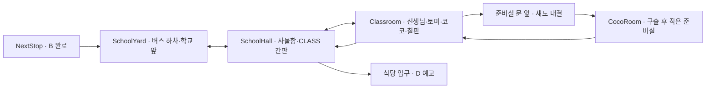

# Stage 3 · C — 미국 학교와 C의 교실!

작성일: 2026-10-25. 상태: 구현 완료. 아래는 구현 기준 계획이며 실행·테스트 정보는 `../docs/MAGIC-ENGLISH-INTEGRATION.md`의 Stage 3 항목을 참고한다.

## 1. 목표와 기준 자료

학교에서 새 친구를 만나고, `Class · Cat · Come`을 상황 속에서 사용한 뒤, 토미와 함께 사일런트 섀도를 물리쳐 코코와 C 소리를 되찾는다. Stage 1의 ‘묻는 용기’, Stage 2의 ‘천천히 읽기’를 Stage 3의 ‘소리 내어 말하는 용기’로 연결한다.

기준 원작:

- `/Users/gimseongjin/english_book/book_1/마법영어_3화_스토리.md` — 사건·영어·인물 관계의 기준.
- 같은 폴더의 `3화_instagram/part1`, `part2` — 페이지별 그림. 2쪽의 파란 사물함·CLASS 교실 입구와 12쪽의 준비실·코코 구출 그림을 직접 확인했다.
- 같은 폴더의 `3화/`에 해당하는 좌우 펼침 이미지 — 후속 구현 시 장면 이미지 원본으로 사용. 실제 디렉터리명에는 유니코드 분해 문자가 포함되어 있으므로 파일 목록에서 경로를 찾아 복사한다.
- `/Users/gimseongjin/english_book/마법영어_세계관_설정.md` — 인물·영어 주문·알파벳 조각 설정.

게임 기준은 `magic-english-stage1.js`, `magic-english-stage2.js`, `magic-english-practice.js`, `magic-english-conversations.js`, `magic-english-learning.js`, `magic-english-storage.js`와 `docs/MAGIC-ENGLISH-INTEGRATION.md`다. Stage 1·2 초기 계획의 옛 보상·단어 단독 말하기 제안보다 현재 실행 코드를 우선한다.

## 2. 현재 구현에서 이어 붙일 지점

- Stage 2 마지막 `s2_next`는 B 완료·보상·C 학교 예고까지만 처리하며 학교 맵으로 이동하지 않는다. 최초 B 완료와 이미 B를 끝낸 저장 양쪽에서 학교로 진입할 수 있게 연결한다.
- 현재 맵 허용 목록은 `JoseonMarket`, `AirportHall`, `BusStop`, `BusInterior`, `NextStop`뿐이다. C 맵을 저장 검증기에 추가하지 않으면 새 저장을 불러올 수 없다.
- 이동 포털, 상호작용 분기, 그리기, 체크리스트, 화면 제목이 A/B 맵을 직접 비교한다. C도 이 지점 전체에 연결해야 한다.
- NPC 한 번의 말하기는 현재 공통 모듈에서 2~5회 문답으로 확장한다. 다중 말하기로 구성한 보스·직원 대화는 기존 순서를 유지한다.
- 보상 API는 Stage 1·2만 허용하고 필수 말하기 원장을 검사한다. Stage 3 허용 범위와 필수 대상 목록도 함께 확장해야 한다.
- 마법영어 개인 저장 키는 이미 중앙 저장 대상이다. 동일 키 안에 `stage3`를 추가하면 최초 이관·10분 저장·재연결 저장을 그대로 사용한다.

## 3. 원작 장면과 게임 진행

| 순서 | 원작 페이지 | 게임에서 하는 일 | 진행 결과 |
|---|---|---|---|
| 1. 학교 도착 | 1~2쪽 | B의 올바른 버스에서 내려 에이미를 따라 복도로 이동. 사물함·알파벳 포스터·CLASS 간판 조사 | 학교 위치와 Class 의미 이해 |
| 2. 교실 입장 | 2~3쪽 | 에이미와 Class 문답 후 교실 문으로 걸어감. 선생님의 `Come in.`에 응답 | 교실 입장·선생님 첫 인사 완료 |
| 3. 코코와 만남 | 3~5쪽의 사건 전 확장 | 교실의 코코·이름표·고양이 그림을 조사하고 Cat 문답 | 코코가 구해야 할 실제 친구로 인식됨 |
| 4. C 소리 도난 | 3~8쪽 | 칠판 앞 첫 자기소개 연출 → 토미의 짧은 웃음 → 섀도 등장 → C 도난 → 코코가 준비실로 피신 | 교실이 어두워지고 CLASS/CAT/COME이 LASS/AT/OME으로 바뀜 |
| 5. 작게라도 말하기 | 6~8쪽 | 링고의 C/c·첫소리 안내, 에이미·활빈과 Come 연습 | 부르는 말과 이동의 의미 연결 |
| 6. 토미와 화해 | 9~10쪽 | 책상 근처 토미와 대화. 사과·격려·함께 연습하는 3회 문답 | 토미가 앞으로 나와 함께하는 친구가 됨 |
| 7. 교실의 C 되찾기 | 10~11쪽 | 칠판·고양이 카드·문 옆 안내판 3곳에서 빠진 C를 고르고 배운 문장 말하기 | 세 단어 복원·보스 대결 준비 |
| 8. 섀도 대결 | 11~12쪽 | 준비실 문 앞에 친구들이 모임. Class → Cat → 코코 부르기의 3라운드 | 섀도 소멸·문 열림·코코 구출 |
| 9. 첫 자기소개 성공 | 13쪽 | C 조각 획득 후 교실 앞으로 걸어가 인사·소개 2회 | 친구들의 박수·Stage 3 완료 |
| 10. 다음은 D | 14~15쪽 | 복도 식당 방향으로 이동. 음식 냄새·미스스펠 예고·D 좌표 | 다음 Stage 연결 지점 생성 |

원작의 사건 순서를 유지한다. 코코와 사전에 짧게 친해지는 장면은 구출 동기를 만드는 게임용 확장이다. C가 사라지는 사건은 반복 연습 중 무작위로 발생하지 않으며 정해진 이야기 지점에서 한 번만 실행한다.

원작에서 실패하는 첫 웅얼거림은 주인공의 짧은 이야기 연출이다. 플레이어가 실제로 정답을 말했는데 의도적으로 실패시키지 않는다. 토미의 놀림은 짧게 다루고 이후 사과와 협력을 반드시 보여 준다.

## 4. 맵과 자연스러운 이동

기존 16px 타일·20×15칸·걷기 포털·A/Space 상호작용을 유지한다. 맵을 크게 늘리기보다 네 공간에 역할을 나눈다.



`준비실 문 앞`은 Classroom 안의 구역이며 별도의 보스 아레나로 순간이동하지 않는다. 네 신규 맵은 SchoolYard, SchoolHall, Classroom, CocoRoom이다. 식당 내부와 D 플레이는 이번 범위에 포함하지 않는다.

| 맵 | 구성·동선 | 움직임·상태 변화 |
|---|---|---|
| SchoolYard | 남쪽 버스 하차점 → 중앙 보행로 → 북쪽 현관. 노란 스쿨버스·운동장·학교 외벽 | 에이미가 현관 옆에서 기다림. 하차 안내는 최초 한 번만 |
| SchoolHall | 양쪽 파란 사물함·알파벳 포스터, 중앙 2칸 이상 통로, 동쪽 CLASS 교실 문, 북쪽 식당 방향 | 학생 2~3명이 짧게 이동. 완료 후 식당 방향에 점심 연출 |
| Classroom | 북쪽 칠판·교탁, 좌우 책상, 남쪽 복도 출입구, 동쪽 준비실 문. 책상 사이·앞쪽에 2칸 통로 | 정상 → 소리 도난·어두움 → 세 단어 복원 → 섀도 소멸·정상. 레이아웃은 유지 |
| CocoRoom | 작은 선반·상자·코코의 숨는 자리. 구출 후에만 진입 | 코코가 문으로 나와 안전한 경로로 친구들에게 접근. 출구 막힘 방지 |

문은 해당 타일로 걸어가면 이동한다. 간판·칠판·NPC는 조사/대화한다. 도착점은 문 바로 앞의 안전한 칸으로 잡고, 같은 문을 즉시 재진입하지 않도록 재진입 방지 규칙을 적용한다.

대화·녹음·분석·장면 연출 중에는 이동을 잠근다. 일반 학생은 지정 영역에서만 걷고 문·퍼즐 상호작용 칸·플레이어·다른 NPC를 막지 않는다. 충돌·경로 검증은 정상 교실과 어두운 교실 모두에서 수행한다.

## 5. NPC 역할과 반응

| NPC | 이야기 역할 | 반복 대화·행동 |
|---|---|---|
| 에이미 | 교실 소개·격려·첫 연습 상대 | 진행 전에는 다음 장소 안내, 완료 후에는 배운 C 문장 2~3회 복습 |
| 링고 | C/c 안내·단서 도감·현재 목표 | C 글자 이름과 이번 단어의 /k/ 첫소리를 구분. ‘C는 언제나 /k/’라고 설명하지 않음 |
| 활빈 | 코코와 먼저 친해지고 Come 시범 | 플레이어 가까이 따라오되 출입구·NPC 앞칸을 피함. Cat/Come 복습 상대 |
| 선생님 | Come in·자기소개를 여는 인물 | 입장 전엔 환영, 사건 중엔 안심시키기, 구출 후엔 발표 기회 제공 |
| 토미 | 놀림 → 두려움 고백 → 사과 → 함께 말하기 | 화해 전엔 책상 근처, 화해 후엔 플레이어와 문 앞에 합류. 완료 후 새 친구 문답 |
| 코코 | 사전 만남·사건의 구조 대상 | 처음엔 교실 안 짧은 이동, 사건 중 준비실 안 야옹·실루엣, 구출 후 안전 경로로 달려 나옴 |
| 반 친구 2~3명 | 학교 생활감·마지막 합창과 박수 | 핵심 동선을 막지 않는 짧은 대화. 사건 단계에 맞는 표정·대사 |
| 사일런트 섀도 | 원작 C 보스 | C 도난·문 봉인·3단계 약화·소멸. 기존 미스스펠의 모습·이름으로 대체하지 않음 |
| 미스터 미스스펠 | 섀도를 보낸 배후·D 예고 | 도입의 짧은 암시와 마지막 식당 예고. C의 실전 보스는 섀도 |

## 6. 영어 연습 수준과 분량

목표는 A/B의 ‘단서 발견 → 짧은 문장 → NPC의 반응과 추가 문답 → 생활 적용 → 보스에서 재사용’을 유지하는 것이다. 핵심 단어는 3개, 한 대화는 2~3회 말하기, 필수 성공 발화는 아래 기준 21회다. 반복 NPC 문답은 선택이다. 초회 플레이 시간은 20~30분을 목표로 하되 실제 음성 인식·이동 테스트로 조정한다.

| 장면 | 플레이어가 말할 문장 순서 | 횟수 |
|---|---|---:|
| Class 발견 · 에이미 | `This is my class.` → `I can see my class.` → `I am ready to go.` | 3 |
| 선생님 입장 문답 | `Good morning!` → `Thank you!` — 교사의 `Come in.`을 듣고 응답 | 2 |
| Cat 발견 · 코코 소개 | `I see a cat.` → `The cat is Coco.` → `The cat is small.` | 3 |
| Come 연습 · 활빈과 역할 놀이 | `Come here!` → `Please come with me.` | 2 |
| 토미와 화해·협력 | `Please come with me.` → `Let us try together.` → `We can do it.` | 3 |
| 3곳 C 복원 | `This is my class.` / `I see a cat.` / `Come here!` 각 1회 | 3 |
| 섀도 3라운드 | `This is my class.` → `I see a cat.` → `Come here, Coco!` | 3 |
| 구출 후 발표 | `Hello. I am Gildong.` → `Nice to meet you.` | 2 |
| 합계 | 필수 경로 기준. 인식 실패 재시도·선택 복습은 별도 | **21** |

게임용으로 확장한 문답은 원작의 핵심 단어·상황을 벗어나지 않는다. Class/Cat/Come 단어와 C/c 카드는 듣기·보기 도감에서 제공하되, 단어 하나를 말하는 것으로 문장 과제를 완료하지 않는다.

각 발화 전후에 실제 상대 NPC의 짧은 질문·반응을 둔다. 예: 선생님 `Good morning!` → 플레이어 `Good morning!` → 선생님 `Come in.` → 플레이어 `Thank you!`. 토미는 자기 두려움을 고백하고 사과한 다음 플레이어에게 도움을 요청한다. 상황과 무관한 공항 후속 질문이 자동으로 붙지 않도록 C 대화 구성을 명시한다.

21회가 자동 확장 때문에 늘어나지 않게 한다. 다중 Speak 대화는 기존 공통 처리와 동일하게 보존하고, C 복원처럼 단일 Speak만 필요한 작업은 명시적인 ‘후속 문답 없음’ 옵션을 추가한다. 이 옵션은 C의 해당 작업에만 적용하며 A/B의 2~5회 문답을 변경하지 않는다.

### 말하기 판정

- 표시 문장·영어 가이드 음성·서버 target 정의가 일치해야 한다.
- 핵심 단어를 올바른 순서로 말하면 기존 정책의 부분 성공, 전체 문장 일치는 완전 성공으로 처리한다. 예: `I see cat`은 부분 성공, `I see a cat`은 완전 성공.
- `Class`, `Cat`, `Come`만 단독으로 말하면 해당 문장 과제는 미완료다.
- `Come here, Coco!`는 Come → here → Coco를 요구한다. `Come here!`만으로 마지막 봉인을 풀 수 없다. Coco/Cocoa 등 인식 표기 변형은 명시적 허용 목록과 테스트로 제한한다.
- C의 /k/ 첫소리 설명은 학습 가이드다. 현재 STT는 인식된 문장을 평가하므로 음소 발음 점수·발성 크기 점수로 표시하지 않는다.
- ‘용기’ 연출은 성공 시 글자·교실이 밝아지는 방식이다. 실제 마이크 볼륨이 작다는 이유로 보스가 강해지거나 이미 통과한 문장이 실패하지 않는다.
- 현재의 가이드 재생 중 다음 잠금, 인식된 오답 추가 2회, 무음·연결 오류 구분을 재사용한다. 실패해도 이전 과제·획득 블록·보스 완료 라운드를 잃지 않는다.
- 오프라인에서는 이미 저장한 진행·도감·준비된 음성을 보존한다. 신규 서버 음성 평가가 필요한 지점은 연결 복구 후 재시도하며 성공을 임의로 만들어 주지 않는다.

## 7. 보스전: 코코 구출이 곧 사일런트 섀도와의 대결

세 복원 지점은 단어를 되찾는 준비 활동이다. 섀도는 준비실 문을 마지막 그림자로 봉인하고, 친구들은 익힌 말을 코코에게 전달하기 위해 문 앞에 모인다. 별도 전투 메뉴나 수학 문제로 전환하지 않는다.

| 라운드 | 상황과 발화 | 성공 시 장면·저장 변화 |
|---|---|---|
| 1 · 교실의 목소리 | 섀도: ‘이 반은 다시 조용해질 거야!’ → `This is my class.` | 3칸 봉인 중 1칸 해제, 칠판 주변 밝아짐 |
| 2 · 친구를 알아보기 | 준비실 창의 코코를 가리키며 `I see a cat.` | 2번째 봉인 해제, 코코 실루엣·야옹 반응 선명해짐 |
| 3 · 친구 부르기 | 에이미·토미가 격려 → `Come here, Coco!` | 마지막 봉인 해제·섀도 소멸·문 열림·코코가 나옴 |

NPC 합창 음성은 플레이어 녹음 전 또는 평가 후에 재생한다. 합창이 마이크로 들어가 플레이어 대신 정답 처리되지 않도록 녹음 중 NPC 소리는 멈춘다.

성공할 때마다 라운드를 즉시 저장한다. 대화 닫기·새로고침 후에는 미완료 라운드부터 재개하며 지난 라운드의 보상·피해·연출을 중복 적용하지 않는다. 코코 이동 연출 중 새로고침하면 코코가 안전한 완료 위치에 있거나 저장된 연출 단계부터 재개한다.

C 조각은 코코 구출 후 한 번 지급하고, Stage 완료는 첫 자기소개를 마친 뒤 확정한다. 도전 시간 제한·패배 시 초기화·목소리가 작다는 벌점은 추가하지 않는다.

## 8. 진행 상태·복원·중앙 저장

저장 키 `magic-english-save-v1:<개인코드>`와 상위 `version: 1`은 유지한다. 기존 A/B 필드를 보존하고 `ensureStage3(state)`로 새 필드만 보충한다.

제안 상태:

```js
stage3: {
  version: 1,
  phase: 'arrival', // class → cat → incident → come → tommy → restore → boss → rescue → introduction → complete
  conversations: {}, // 대화 ID별 성공한 발화 순번·완료 여부
  words: { class: false, cat: false, come: false },
  incidentSeen: false,
  tommyReconciled: false,
  restored: { class: false, cat: false, come: false },
  boss: { round: 0, completed: false }, // 0~3, 완료된 라운드 수
  rescue: { phase: 'locked', completed: false },
  fragmentC: false,
  introductionCompleted: false,
  completed: false,
  dHookSeen: false
}
```

- phase는 선행 조건·완료 플래그에서 계산하거나 함께 검증하여 서로 모순되지 않게 한다. 퀘스트 완료는 해당 대화의 마지막 성공 발화 뒤에만 확정한다.
- 개별 발화는 성공 시 체크포인트로 남겨 대화 도중 닫아도 연습 전체를 매번 처음부터 요구하지 않는다. 부분 완료를 퀘스트 완료로 오인하지 않는다.
- 신규 맵 저장 검증·정상 좌표·스폰 검증·초상화·목표 표시·도감에 C를 등록한다. 불러오기 실패를 새 게임으로 대체하지 않는다.
- B 미완료면 정상 B 진행을 유지한다. 기존 B 완료 저장에는 C 시작 경로만 열고 C 완료·보상은 소급 부여하지 않는다. B 마지막 게이트 반복 조사로 B 보상이 늘어나지 않게 한다.
- C 진행 중 A/B 구역을 다시 방문해도 stage3가 지워지지 않게 하고, ‘다음 모험’으로 학교의 안전한 마지막 위치로 돌아올 수 있게 한다.
- 기존 중앙 저장 모듈이 같은 개인 저장 키 전체를 저장하므로 별도 C 키나 별도 동기화 타이머를 만들지 않는다. 상단 서버 저장 상태 문구도 다시 추가하지 않는다.

## 9. 음성·이미지·보상

### 원작 자산과 NPC 음성

- `assets/stage3/page01.jpg`~`page16.jpg`: 원작 페이지에서 파생하고, 변환 도구에 입력 원본과 페이지 번호를 기록한다. 주요 삽입 장면은 도착·도난·C 안내·토미 화해·합창·코코 구출·조각·D 예고다.
- 맵은 기존 픽셀 게임의 타일 크기·명암과 원작의 파란 사물함·칠판·책상·준비실 모티프를 맞춘다. 만화 이미지를 지도 배경으로만 붙여 이동을 대체하지 않는다.
- 신규 스프라이트는 선생님·토미·코코·섀도 및 학생 변형. 섀도는 어두운 교실에서도 구분되는 눈·윤곽을 사용한다.
- 에이미·링고·활빈·길동의 기존 고정 배역은 유지한다. 선생님·토미·섀도는 `character-voices.js`에 명시적 배역과 speaker 매핑을 등록하여 기본 에이미 목소리로 잘못 재생되지 않게 한다.
- 첫 구현의 음색 제안: teacher는 기존 staff/Bill 계열, tommy는 kid/Fena 계열, shadow는 Bill 기반 별도 그림자 효과. 새 외부 음성 구매를 선행 조건으로 두지 않는다.
- 신규 영어 가이드·질문·반응·보스 대사·마무리를 `assets/audio/stage3/`에 사전 생성하고 manifest로 관리한다. 기기 기본 음성으로 대체하지 않는다. 생성은 별도 개발 작업이며 빌드에서 유료 음성을 생성하지 않는다.

### 현재 보상 정책을 C에 그대로 확장

- 성공 발화: 기본 블록 5종 중 랜덤 1종, 부분 1개/완전 2개, 같은 수의 하트. 완전 성공은 기존 20% 무기 추첨 유지.
- C 조각: 돌 1개 + 하트 1개, 고정 ID `stage3:fragment:v2`로 한 번.
- Stage 3 완료: 원목·흙·돌 각 5개 + 하트 15개, 고정 ID `stage3:clear:v2`로 한 번.
- 선택 반복 대화의 새 성공 발화는 기존처럼 보상을 받을 수 있다. 동일 발화의 서버 토큰·요청 재시도는 중복 지급하지 않는다.
- 보상 API의 stage 허용 범위를 3까지 확장하고 C 대상 등록·필수 원장 조건을 추가한다. fragment는 C 3종 문장·토미 협력·코코 부르기 성공 원장을 요구하고, clear는 fragment 영수증과 마지막 자기소개 성공 원장을 추가로 요구한다.
- C 전용 target ID 예: `s3_class`, `s3_cat`, `s3_come`, `s3_together`, `s3_call_coco`, `s3_introduction`. 기존 일반 대화 성공이 C 완료 조건을 우연히 충족하지 않게 구분한다. 보스 성공 순서는 게임 상태에서 별도로 관리한다.
- 로컬 저장과 네트워크를 하나의 트랜잭션으로 가장하지 않는다. 진행 확정 → 기존 보상 대기열 등록 → 서버 원장 확정 → 건축 수령 순서를 사용하고, 각 단계의 재시도를 안전하게 처리한다.

## 10. 구현 작업 묶음

| 순서 | 주요 파일·산출물 | 확인할 결과 |
|---|---|---|
| 1. 이야기·학습 데이터 | `magic-english-stage3.js` 신규, C 목표·체크리스트·전이·대화 표 | 원작 1~15쪽 대응, 필수 21회·대상 문장 확정 |
| 2. 저장·B 연결 | `magic-english-storage.js`, `magic-english-portals.js`, 기존 컨트롤러의 B 마지막 게이트 | 기존 B 완료에서 학교 도착, A/B·중앙 저장 유지 |
| 3. 맵·인물 | 4개 C 맵·렌더러·스프라이트·충돌·NPC 짧은 이동 | 학교 앞 → 복도 → 교실 → 준비실 경로가 실제로 이어짐 |
| 4. 문답·판정 | `magic-english-practice.js`, `magic-english-conversations.js`, `magic-english-learning.js`, C 대화 정의 | 가이드·표시·서버 판정 일치, C 전용 대상·문답 수 유지 |
| 5. 이야기·보스 | C 컨트롤러/전이, 기존 `magic-english-stage1.js`의 단계별 dispatch | 소리 도난 → 토미 화해 → 복원 → 3라운드 → 구출 → 발표 |
| 6. 음성·보상·완료 | `character-voices.js`, 정적 음성·이미지, `lib/magicEnglishApi.cjs`, D 예고 | 새 배역·보상 원장·건축 전달·완료 후 반복 대화 |
| 7. 검증·문서 | C 단위 테스트·C 전용 브라우저 시나리오, 통합 안내 갱신 | 완료 기준 충족·관련 A/B 회귀·빌드 성공 |

기존 컨트롤러가 크므로 C 세부 로직은 신규 모듈로 분리한다. 공통 ‘현재 맵에 맞는 목표/렌더/행동 선택’ 지점만 최소한으로 확장하고 A/B 전체 구조를 동시에 재작성하지 않는다.

## 11. 완료 기준과 검증 계획

- [ ] 기존 B 완료 저장과 새 B 완료 양쪽에서 C에 진입하며 B 보상 중복이 없다.
- [ ] C의 핵심 단어·맵·인물이 원작과 대응하고, 코코를 만나기 전에 구출이 끝나는 순서 오류가 없다.
- [ ] 필수 경로의 말하기 21회와 선택 복습이 분리되며 NPC 질문·반응이 번갈아 나온다.
- [ ] Class/Cat/Come 단어 단독·무음·문장 순서 오류는 문장 퀘스트를 통과하지 못한다.
- [ ] `Come here!`는 연습 성공이지만 마지막 `Come here, Coco!` 봉인을 통과시키지 못한다.
- [ ] 올바른 작은 목소리는 인정하고, 실제로 말하지 않은 강제 실패·볼륨 벌점·NPC 음성에 의한 대리 성공이 없다.
- [ ] 정상/어두움/복구 교실 모두에서 모든 필수 대상에 접근 가능하며 NPC·코코가 출입구를 막지 않는다.
- [ ] 보스 1·2라운드 성공, 구출 이동 중, C 조각 화면, 마지막 발표 중 각각 새로고침해 안전하게 이어진다.
- [ ] C 조각·완료 보상이 1회만 적용되고 음성 성공 보상·하트·무기·기존 건축이 유지된다.
- [ ] 기존 A 진행·B 진행·B 완료·C 중간 저장의 호환성을 확인한다.
- [ ] 개인 URL의 다른 브라우저 복원과 오프라인 변경 후 중앙 저장이 C 상태도 보존하며, 상단 서버 저장 문구는 나타나지 않는다.
- [ ] 모바일/iPad에서 이동·NPC 대화·가이드·녹음·다음 버튼·보스 UI가 사용 가능하다.
- [ ] D는 식당 예고와 향후 진입 지점까지만 제공하고 미구현 공간으로 이동하지 않는다.

개발 시 `magic-english-stage3.test.js`, `magic-english-stage3-learning.test.js`, C 보상 API 테스트를 추가하고 관련 A/B·대화·저장 테스트만 실행한다. C 전용 브라우저 시나리오에서는 B 완료 fixture에서 시작해 필수 경로와 중간 복원 지점을 확인한다. 실제 아동 음성·iPad 마이크는 기기 검증을 별도로 수행한다. 신규 자산과 배포 경로 확인에는 `npm run build`를 사용하며, 관련 없는 전체 게임 테스트는 실행하지 않는다.

## 12. 범위 경계

이번 구현은 원작 3화의 학교 모험·C 학습·코코 구출·C 조각·D 예고까지다. D의 식당 플레이, 자유 입력 영어 회화 AI, 실시간 발음 음소 채점, 대형 학교 전체 지도, 신규 상점·보상 경제는 포함하지 않는다.

## NPC 퀘스트 전환 (2026-10-26)

CLASS 안내판, 고양이 카드, 첫 발표 자리, C 복원 오브젝트는 배경 장식으로 유지하고 퀘스트 대상에서 제거했다. 핵심 진행은 NPC로 이어진다.

1. 복도의 에이미: Class 3턴 → 교실 선생님: 인사 2턴.
2. 미술 선생님 또는 코코: Cat 3턴 → 선생님에게 다시 말 걸어 첫 발표 사건.
3. 링고: Come 2턴 → 토미: 함께하는 용기 3턴.
4. 선생님: CLASS / 미술 선생님: CAT / 링고: COME 각각 C 선택과 문장 1회.
5. 준비실 옆 사일런트 섀도 NPC: 대결 3회 → 코코 구출·C 배지.
6. 선생님: 자기소개 2회 → C 완료 → 복도의 식당 출구로 D 이동.

필수 발화는 기존 21회, 보상·저장·D 연결은 유지한다. 발표 사건은 대화를 끝낸 뒤 기록하므로 도중에 닫으면 선생님에게 다시 말을 걸어 이어갈 수 있다. 기존 오브젝트 ID는 과거 내부 호출과 저장 호환을 위해 컨트롤러 별칭으로 남겨 두지만 맵에는 NPC와 이동 출구만 등록한다.
